<b>1 &nbsp; "narrator, who's this amazing person in question?"</b>

runor, a student, who likes computers, thinking, people. 
that is all.

<b>2 &nbsp; "narrator, what does runor do?"</b>

runor attends classes. when not busying themselves with school work, runor tends to work on certain computer projects, some of which are public on here! when not doing school work orrrr busying themselves with their computer, runor plays a ton of games. most of them being gacha games right now as that's all they have time for.
these gacha games include wuthering waves, honkai star rail, neverness to everness, some zenless zone zero and previously, genshin impact. OH! how could i forget, runor also watches a bit of anime (a bit is an understatement).

<b>3 &nbsp; "what about sleep?? does runor sleep??"</b>

yes.

<b>4 &nbsp; "narrator, is 'ssj' a Dragon Ball reference?"</b>

what do you think?

<b>5 &nbsp; "you, you are reading a README"</b>

this is a filler. i haven't much to put here. 
thanks for reading~

you, [follow runor](https://github.com/ssjrunor).
